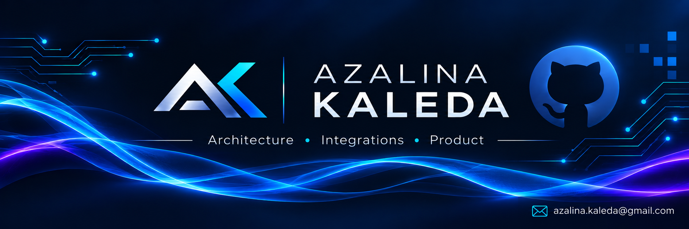

## Hi there 👋

<!--
**azalina-sa/Azalina-SA** is a ✨ _special_ ✨ repository because its `README.md` (this file) appears on your GitHub profile.

Here are some ideas to get you started:

- 🔭 I’m currently working on ...
- 🌱 I’m currently learning ...
- 👯 I’m looking to collaborate on ...
- 🤔 I’m looking for help with ...
- 💬 Ask me about ...
- 📫 How to reach me: ...
- 😄 Pronouns: ...
- ⚡ Fun fact: ...
-->

<!-- ## AZALINA KALEDA
**Technical Business Analyst | Technical Product Manager** 
### Technical Business Analyst | Technical Product Manager
**Technical Business Analyst • Technical Product Manager**
Email: azalina.kaleda@gmail.com -->

### 👤 PROFESSIONAL SUMMARY

Highly analytical and tech-driven **Technical Business Analyst / Technical Product Manager** with **14+ years** of extensive experience in designing backend requirements, platform specifications, and system integrations. Proven track record of translating business goals into precise technical specifications, API contracts, and process flow diagrams across web, mobile, and enterprise platforms. Exceptional skills in driving cross-functional alignment between engineering teams and business stakeholders, managing product scope (PRDs), and ensuring stable feature delivery.  

---

### 🛠 TECH STACK & TOOLS

`REST API` `Swagger` `OpenAPI` `JSON` `Apache Kafka` `Oracle DB` `PostgreSQL` `SQL` `Python` `Postman` `Jira` `Confluence` `MS Visio` `draw.io` `BPMN 2.0` `UML`  

---

### ⚡ TECHNICAL & CORE SKILLS
  
* **Product & Requirements Management**: Technical Product Management, Product Requirements Documents (PRDs), Requirements Gathering, Functional Specifications (User Stories / Use Cases), Effort Estimation. 
* **APIs & System Integration**: RESTful API Design, Event-Driven Architecture (Message Brokering), JSON Payload Modeling, Legacy-to-Web System Migration. 
* **Data & Process Modeling:** Relational Data Modeling, Query Optimization, Business Process Modeling, End-to-End Sequence & Data-Flow Design. 
* **Domain Expertise**: Backend Development Logic, Warehouse Management Systems (WMS), PSIwms, Manhattan WMS, Pilot Support. 
* **Domain Expertise:** Warehouse Management Systems (PSIwms, Manhattan WMS), Supply Chain & Logistics Automation, Telecom Digital Platforms, Pilot Launch & UAT Support. 

---

### 💼 PROFESSIONAL EXPERIENCE

#### **BEELINE** (Top-Tier Telecom Carrier with 50M+ Subscribers) | *Moscow, Russia*  
**Senior Systems Analyst** • *May 2024 — September 2026* 
 
🛠 **Stack:** `Python` `Angular` `React` `PostgreSQL` `Oracle DB` `Apache Kafka` `iOS/Android` `Confluence` `Jira`

 
Key Impact & Role

  
  
📱 **Authored detailed technical specifications and backend requirements** for digital infrastructure web and mobile applications (iOS/Android), acting as a primary technical bridge between business goals and development/QA teams. 
🔌 **API Specification & Design:** Documented RESTful API contracts and JSON payload schemas using Swagger, mapping data-flow integrations between front-end interfaces and backend services. 
📝 **Technical Writing & PRDs:** Developed end-to-end Product Requirements Documents (PRDs), comprehensive functional requirements (Use Cases / User Stories), and process flow diagrams with zero ambiguity. 
🎯 **Lifecycle Technical Ownership:** Managed specifications from initial stakeholder gathering through UI/UX alignment, effort estimation, and testing (QA), successfully eliminating requirement drift and accelerating time-to-market. 

---
 
#### **X5 GROUP** (Europe’s Leading Retail & Logistics Network) | *Moscow, Russia*  
**Senior Systems Analyst / Technical Product Manager** • *May 2017 — November 2023* 
 
🛠 **Stack:** `Java` `Oracle` `SQL` `Manhattan WMS` `Apache Kafka` `Delphi` `Forte` `iOS/Android` `Confluence` `Jira`

 
Key Impact & Role

  
  
📦 **Managed technical documentation and integration specifications** for core Warehouse Management Systems (WMS) across an enterprise logistics infrastructure, translating operational business goals into developer-ready specifications. 
🔄 **WMS Legacy System Modernization (2022–2023)**: Authored technical specifications and functional requirements to transition legacy desktop applications (Delphi/Forte) into a web-based platform, documenting existing system logic and RESTful API contracts (JSON schemas) to accurately preserve and transfer core system functionality. 
📊 **Manhattan WMS Implementation (2020–2022)**: Facilitated requirements gathering sessions with operational stakeholders to define functional requirements and authored comprehensive specifications, end-to-end Use Cases, and process flow diagrams to guide engineering teams. 
⚙️ **Enterprise Software Modification (2017–2020)**: Managed continuous feature enhancements for in-house applications and desktop-based WMS modules, analyzing operational requests to write functional specifications and supporting pilot launches. 

---

#### **MILAVITSA** (Manufacturing & Logistics Network) | *Minsk, Belarus*  
**Technical Business Analyst** • *October 2012 — October 2014* 

 
Key Impact & Role

  
  
 ⚙️ **Actively contributed to the technical integration and deployment** of an automated logistics center, collaborating on the rollout of the PSIwms platform, SSI SCHAEFER conveyor systems, and EuroSort sorting lines. 
📊 **Translated complex business needs** into comprehensive technical requirements and BPMN process flow diagrams to align international hardware and software vendors with product specifications. 
🧪 **Executed rigorous integration and end-to-end (E2E) testing** across software and hardware layers, working through deployment challenges to successfully stabilize and launch the pilot system. 

---

#### **CAPITAL LOGISTIC** (Logistics & Supply Chain) | *Minsk, Belarus*  
**Business Systems Analyst** • *December 2010 — September 2012*  

 
Key Impact & Role

  
  
 🌐 **Contributed to the technical deployment of the Logistic Vision WMS** platform, customizing the system to align with specific customer operational workflows. 
⚙️ **Designed operational process models (BPMN)** to ensure system integration and monitored vendor development progress against requirements. 
🚀 **Executed user acceptance testing (UAT)** and provided dedicated analytical support during pilot implementation and rollout phases. 

---

### 🎓 Education & Certifications

* **B.Sc./M.Sc. in Information Technology & Systems Control Engineering** — *Belarusian State University of Informatics and Radioelectronics (BSUIR)* | 2007
* **Apache Kafka for Developers** — Event-Driven Architecture & Message Brokering | *2025*
* **Oracle 12c: PL/SQL Fundamentals** — Advanced Relational Database Design & Query Optimization | *2017*

---

### 📬 Get in Touch
* **Telegram:** [@LinaSuvv](https://t.me/LinaSuvv)
